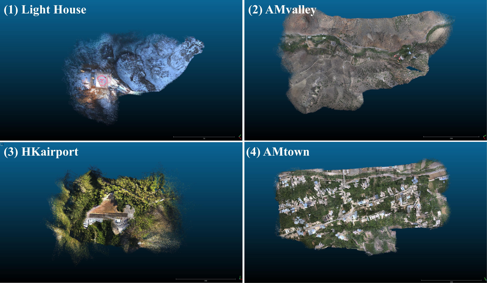
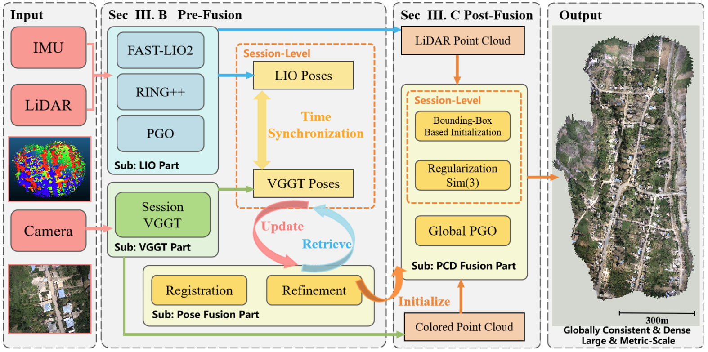

# LiDAR-VGGT

**Cross-Modal Coarse-to-Fine Fusion for Globally Consistent and Metric-Scale Dense Mapping**

[](https://ieeexplore.ieee.org/abstract/document/11399876)
[](https://arxiv.org/abs/2511.01186)

Lijie Wang, Lianjie Guo, Ziyi Xu, Qianhao Wang, Fei Gao, and Xieyuanli Chen

Official implementation of **LiDAR-VGGT**, published in *IEEE Robotics and Automation Letters*, 2026. LiDAR-VGGT combines LiDAR-inertial odometry with visual geometry models to reconstruct dense, metric-scale colored maps.



*Dense colored reconstructions across Lighthouse, AMvalley, HKairport, and AMtown.*

## Overview



*System overview of LiDAR-VGGT: pose fusion and point-cloud fusion for globally consistent, metric-scale dense mapping.*

The repository supports **VGGT**, **Pi3**, and **VGGT-Omega**, with two alignment methods:

| Method | Alignment |
| --- | --- |
| `baseline` | Original pipeline: trajectory initialization → regularized point-cloud Sim(3) → ICP |
| `correspondence` | Additional pipeline: calibrated LiDAR-to-image projection → pointmap correspondences → RANSAC + Umeyama Sim(3) |
| `both` | Run both methods with shared model predictions |

## Installation

Use Python 3.10 or 3.11, Git, and a CUDA-capable NVIDIA GPU. Run from the repository root:

```bash
git clone https://github.com/NorwegianSmokedSalmon/LiDAR-VGGT.git
cd LiDAR-VGGT
bash tools/setup_env.sh
source .venv/bin/activate
```

The setup script installs dependencies and downloads all three models. To install only VGGT, use `bash tools/setup_env.sh vggt`. For an existing environment:

```bash
python tools/download_models.py --models all
```

VGGT-Omega weights download from ModelScope by default. See [model setup](models/README.md) for sources and checkpoint options.

## Quick Start

### From a ROS bag

Raw-bag processing requires the `lemon-mapping:fastlio` Docker image with per-scan export support. See [bag preparation](docs/bag_pipeline.md) for the image interface and calibration presets.

```bash
export OMP_NUM_THREADS=4 OPENBLAS_NUM_THREADS=4

python tools/run_bag_pipeline.py \
  /path/to/AMtown02.bag /path/to/HKisland03.bag \
  --model vggt --method both
```

This runs FAST-LIO, selects keyframes after takeoff, reconstructs all chunks, and merges them into complete maps. Change `--model` to `pi3` or `vggt_omega`; use `--method baseline` or `--method correspondence` to run a single method.

MUN-FRL Lighthouse bags are also supported, including the workshop sample:

```bash
python tools/run_bag_pipeline.py /path/to/lighthouse_francis_sample.bag \
  --model vggt --method both
```

The Lighthouse preset handles VLP-16 scans, DJI M600 calibration, and fisheye rectification. See [Lighthouse preparation](docs/bag_pipeline.md#mun-frl-lighthouse) for timing and dataset details.

Results are saved to `outputs/from_bag/<sequence>/<model>/<method>/`:

- `merged_map.ply`: merged colored point cloud.
- `merged_map_0.1m.ply` / `.pcd`: voxel-downsampled maps.
- `map_preview.png`: map preview.

### From prepared data

Configure image paths, LiDAR scans, poses, and calibration as described in [prepared-data reconstruction](docs/reconstruction.md), then run:

```bash
# Original alignment pipeline
python tools/run_pipeline.py --config config/config.yaml \
  --model vggt --all-images --merge --output-dir outputs/baseline

# Calibrated correspondence alignment
python tools/run_projection_pipeline.py --config config/projection_amtown.yaml \
  --model vggt --all-images --merge --output-dir outputs/correspondence
```

## Python PGO

Refine overlap alignment after either registration method, using any of the three models:

```bash
python tools/run_pgo.py \
  --result-dir outputs/from_bag/HKairport03/pi3/correspondence \
  --config config/pgo.yaml --tune --regenerate-predictions
```

Omit `--regenerate-predictions` when the original prediction cache is available. A cleaned result can be restored into compact PGO inputs without retaining dense prediction arrays. Results go to `<result-dir>/pgo/`; use a new `--output-dir` for another experiment.

For a new bag run, add `--pgo --pgo-tune` to `tools/run_bag_pipeline.py`. Select settings with `--pgo-config config/pgo.yaml`.

| Constraint / parameter | Default |
| --- | --- |
| `prior.mode` | `sequence_first`; use `chunk_first` to fix every chunk start |
| Fixed camera poses | Exact anchors; strongest prior |
| Model odometry weight | `10.0` |
| Overlap correspondence / ICP weight | `1.0`; strictly below odometry |
| Translation / rotation normalization | `0.2 m` / `1 degree` |
| Correspondence RANSAC / ICP distance | `3.0 m` / `1.0 m`; VGGT RANSAC uses `5.0 m` |
| ICP weights searched by `--tune` | `0.1`, `0.3`, `1.0` |

PGO keeps each chunk's metric scale, optimizes camera poses and re-exports the colored map. Overlap pixels are split into fitting, tuning and test sets. The default fixes only the sequence start, so later chunks can move relative to their initial LiDAR alignment. Use `--prior-mode chunk_first` to preserve every chunk start (validated on AMvalley03). A tuning guard retains the original geometry if optimization worsens tuning RMSE. See [PGO configuration and validation](PGO/README.md) for all settings, weight definitions and diagnostics.

## Companion Repositories

We also provide dedicated repositories for map evaluation and bundle adjustment:

| Repository | Purpose |
| --- | --- |
| [Color-Map-Evaluation](https://github.com/NorwegianSmokedSalmon/Color-Map-Evaluation) | Colored-map quality evaluation with metric reports and visual diagnostics. |
| [LiDAR-VGGT-Bundle-Adjustment](https://github.com/NorwegianSmokedSalmon/LiDAR-VGGT-Bundle-Adjustment) | Cross-modal bundle adjustment based on BALM2, jointly refining LiDAR and VGGT poses through point-cloud geometry. |

See each repository for installation, input formats, and usage.

## Code Structure

| Directory | Purpose |
| --- | --- |
| [`models/`](models/) | Model downloads, adapters, preprocessing, and shared inference |
| [`Registration/`](Registration/) | Sim(3) alignment, initialization, and regularization |
| [`tools/`](tools/) | Pipeline entry points, bag processing, map export, and diagnostics |
| [`config/`](config/) | Reconstruction settings and sensor calibration presets |
| [`PGO/`](PGO/) | Python pose graph optimization and overlap refinement |
| [`Utils/`](Utils/) | Shared point-cloud I/O and transform utilities |
| [`docs/`](docs/) | Bag preparation and prepared-data workflows |
| [`evaluation/`](evaluation/) | Compatibility metric scripts; full toolkit linked above |
| [`tests/`](tests/) | Regression tests (`python -m unittest discover -s tests`) |

## Acknowledgments

This project builds on [VGGT](https://github.com/facebookresearch/vggt), [Pi3](https://github.com/yyfz/Pi3), [VGGT-Omega](https://github.com/facebookresearch/vggt-omega), and [FAST-LIO](https://github.com/hku-mars/FAST_LIO).

## Citation

If you use this project in your research, please cite:

```bibtex
@article{wang2026lidarvggt,
  author  = {Lijie Wang and Lianjie Guo and Ziyi Xu and Qianhao Wang and Fei Gao and Xieyuanli Chen},
  title   = {{LiDAR-VGGT}: Cross-Modal Coarse-to-Fine Fusion for Globally Consistent and Metric-Scale Dense Mapping},
  journal = {IEEE Robotics and Automation Letters},
  year    = {2026},
  volume  = {11},
  number  = {4},
  pages   = {4721--4728},
  doi     = {10.1109/LRA.2026.3666387}
}
```
